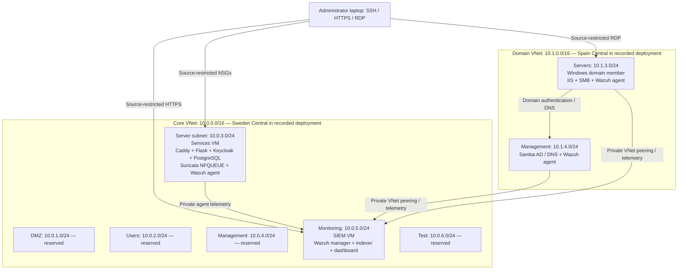

# Azure Security Lab — Identity, Detection & Response

An Azure student lab that connects segmented networks, application access control, endpoint monitoring, and host-based intrusion prevention. The project demonstrates a complete, controlled workflow: **generate a test event → detect it in Wazuh → change a Suricata rule → verify blocking while normal traffic still works**.

This repository contains the infrastructure templates, Python demo application, installation scripts, custom detection rules, and sanitized results. It is an infrastructure and security engineering project; the application is a small test workload used to demonstrate the controls.

**Environment:** Azure for Students · Ubuntu 22.04 · Windows Server 2022 · Keycloak · Samba AD · Wazuh · Suricata · Caddy · Flask · PowerShell · ARM templates

**Status:** deployed and tested in a student subscription in September 2026. The public package has been reorganized and parameterized for reuse; it has not been redeployed from scratch as a complete public package. Historical results do not imply the Azure resources are currently running.

## Start here

| Interest | Read |
|---|---|
| Understand the design and tradeoffs | [Architecture](docs/architecture.md) |
| See actual recorded results | [Validation evidence](evidence/README.md) |
| Reproduce the lab in your own subscription | [Deployment guide](docs/deployment.md) |
| Understand detection and the purple-team exercise | [Detection and response](docs/detection-and-response.md) |
| Record a short practical demonstration | [Demo walkthrough](docs/demo.md) |

## Architecture



NSGs control subnet traffic. The two VNets are privately peered. The empty DMZ, user, management, and test subnets represent reserved network zones; they are not populated enterprise networks. Suricata protects selected traffic on the services VM, not all traffic across these VNets.

## What the project demonstrates

| Control | Implementation | Evidence and limits |
|---|---|---|
| Network segmentation | Five conceptual network zones, an additional test subnet, NSGs and private VNet peering | Recorded bounded port tests: agent ports reachable; administration and indexer ports denied from the services VM |
| Application identity | Keycloak realm, OIDC authorization code with PKCE, TOTP enrollment and `lab-user` role | Authorized workspace and authenticated-but-denied HTTP 403 paths; application JSON audit events |
| System identity | Samba AD domain `pfa.test`, Windows membership, `LabUsers` group | Domain membership and secure channel checked; SMB policy configured, full per-user SMB testing remains a follow-up |
| Central monitoring | Wazuh all-in-one server and three endpoint agents | Recorded FIM, invalid SSH user, sudo denial and Suricata alerts |
| Intrusion prevention | Suricata NFQUEUE on host web traffic and post-TLS loopback HTTP | Signature-specific blocked events plus successful normal-traffic checks; queue bypass is fail-open |
| Purple teaming | Bounded synthetic tests with a manual detection-to-prevention response | Before/after results are included; this is not automated SOAR or a full adversary emulation |
| Backup exercise | Local encrypted restic backup and restore comparison | Same-VM restore test; not off-site disaster recovery |

## A recorded detection-to-prevention result

On **27 September 2026**, the controlled `/pfa-purple-probe` request produced:

| Phase | Client result | Security evidence |
|---|---|---|
| Detection | HTTP `404`: request reached the application, whose route did not exist | Suricata SID `1000003`, action `allowed`; Wazuh rule `86601` |
| Manual response | Change only the purple exercise signature from `alert` to `drop` | Suricata configuration tested before restart |
| Retest | curl timeout, exit `28`, status `000` | Suricata action `blocked`; custom Wazuh rule `100110`, level `10` |
| Regression check | `/health` returned HTTP `200` | Normal application traffic still succeeded |

The timeout alone would not prove prevention. The matching blocked events and successful health request support that conclusion. See the [sanitized result file](evidence/validation-summary.json) and [its provenance](evidence/README.md).

## Engineering decisions

- **Work within student constraints:** two regions were used because of regional policy, VM availability and vCPU quotas. This was not a high-availability design.
- **Separate identity responsibilities:** Azure administration uses the existing Azure account; Keycloak handles application users; Samba handles the Windows domain. Keycloak does not replace Azure RBAC, and Keycloak and Samba are not federated in this lab.
- **Prove the whole logging chain:** inspect local events, agent transport, manager rules, indexing and dashboard filters when an alert is missing.
- **Keep tests bounded:** synthetic file changes, one invalid SSH principal, a denied privilege request and known HTTP test signatures; no exploit or credential theft is required.
- **Document gaps:** a missing sudo-denial alert led to custom rule `100121`; the recorded subsequent exercise contains the resulting detection.

## Repository layout

```text
app/                 Flask OIDC demonstration application
infra/               ARM network, core VM and optional domain templates
config/              Example configuration using documentation-only public IPs
scripts/             PowerShell orchestration, Linux installers, Windows setup
detections/          Custom Wazuh XML and Suricata signatures
docs/                Design, deployment, investigation, demo and publishing guides
evidence/            Sanitized historical validation results
tools/               Offline repository validation
.github/workflows/   Static checks; no Azure deployment or cloud credentials
```

## Reuse and validation

Start with [deployment prerequisites and stages](docs/deployment.md). Cloud deployment creates billable resources; there is no one-command unattended installation. The installers target fresh lab VMs and require review before execution.

Local checks, without Azure access:

```powershell
python tools/validate_repo.py
.\tools\Test-PowerShellSyntax.ps1
```

The GitHub workflow also checks Bash syntax and the pure-Python evidence collector. Static checks do not validate subscription quota, live OIDC authentication, Azure template expressions or current VM health.

## Limitations and next steps

This is a teaching lab, not a production deployment. There is no Azure Firewall, managed Bastion, VPN gateway, ExpressRoute, Private Link, redundant SIEM, or automatic incident containment. Public access is restricted except HTTP used for certificate validation and redirects. Package egress remains broad. Some software versions are pinned and others float; review and pin dependencies before rebuilding.

Potential improvements: off-host backups and restore exercises, private administrative connectivity, a federated identity design, stricter egress, validated broader detection coverage, controlled response approval, and reproducible end-to-end deployment checks.

See [SECURITY.md](SECURITY.md) for credential handling and [publishing instructions](docs/publishing.md) for making this repository part of a portfolio. No live endpoints, passwords, SSH keys, subscription identifiers, or private internship reports are included.
