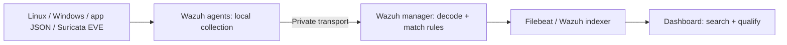

# Detection rules and purple-team workflow

## The event pipeline



Suricata detects or blocks selected traffic. It writes EVE JSON on the services VM. The Wazuh agent reads that file and the application's audit JSON. The manager applies rules; the indexer makes resulting alerts searchable in the dashboard.

Not every raw event becomes an alert. Rule matching, severity, indexing delay, timestamp filters and dashboard selection all matter. When an expected alert is missing, check each stage rather than immediately concluding that the sensor missed the event.

## Custom versus built-in rules

| Rule | Owner | Meaning | Public source |
|---|---|---|---|
| `100100` | Project | Authorized application login audit event | [application.xml](../detections/wazuh/application.xml) |
| `100101` | Project | Authenticated application user denied by role policy | [application.xml](../detections/wazuh/application.xml) |
| `100102` | Project | Explicit synthetic response-test event | [application.xml](../detections/wazuh/application.xml) |
| `100110` | Project | Suricata event has action `blocked`, severity raised to level 10 | [ips.xml](../detections/wazuh/ips.xml) |
| `100121` | Project | Specific PAM sudo denial for `pfa-app` | [sudo-denial.xml](../detections/wazuh/sudo-denial.xml) |
| `554` / `550` | Wazuh built-in | File creation / modification in the recorded run | Vendor rules on manager |
| `5710` | Wazuh built-in | Invalid SSH user | Vendor rules on manager |
| `86601` | Wazuh built-in | Suricata alert parent matched in this lab | Vendor rules on manager |

Custom files are installed under `/var/ossec/etc/rules/`. Do not edit vendor rules under `/var/ossec/ruleset/rules/`. Test manager configuration with `/var/ossec/bin/wazuh-analysisd -t` before restart.

Rule `100102` labels synthetic evidence. Its existence is not a claim of automatic response. Rule `100110` matches any Suricata blocked alert that matches its parent; the selected purple evidence uses SID `1000003`.

## Suricata signatures

| SID | Default action | Purpose |
|---|---|---|
| `1000001` | `alert` | URI `/pfa-ids-check`, controlled IDS check |
| `1000002` | `drop` | URI prefix `/pfa-ips-block`, controlled IPS check |
| `1000003` | `alert`, manually changed to `drop` | URI prefix `/pfa-purple-probe`, purple-team loop |

[lab.rules](../detections/suricata/lab.rules) shows the signatures. The IPS installer initially writes SIDs `1000001` and `1000002`; `Prepare` adds or updates `1000003`. This is a small demonstration ruleset, not comprehensive network attack coverage.

## Exercise stages

Use [purple-team.ps1](../scripts/purple-team.ps1) with a local configuration. It expects SSH key access to the services and SIEM VMs, with their host keys already verified in a known-hosts file.

### Prepare

Create a run identifier and UTC start time. Upload the three helpers. Set only SID `1000003` to `alert`, retaining the existing IPS signature `1000002`. Validate Suricata configuration, then restart. This does not provision the Azure environment.

### Exercise

Generate bounded tests on the owned lab:

- Try six known ports on the private SIEM address `10.0.5.10`. Expected: `1514/1515` reachable; `22/443/5601/9200` unreachable from the services VM.
- Create and modify a synthetic canary file in the monitored directory.
- Attempt `sudo -n /usr/bin/id` as the unprivileged `pfa-app` account. Expect denial.
- Make one SSH attempt using a non-existent `pt-<run>` principal. Expected permission denial is a test result, not a deployment failure. A connection timeout does not prove this test succeeded.
- Request `/pfa-purple-probe`. In alert mode the request reaches Flask, which returns `404` because the route does not exist. Suricata should record `allowed`.

### Collect

Read recent EVE and Wazuh alert records and select events for this run. The collector is bounded to the last 100,000 lines in the current file; rotated logs and older events are not included. Wait for ingestion and collect again if necessary.

FIM paths, the unique SSH principal and the HTTP run query identify specific tests. The sudo event is selected by account and time window; simultaneous actions by the same account can also appear and need qualification. A successful collection command does not imply every expected event was found.

### Respond

Require an actual Wazuh `web_probe` event with action `allowed`. Then manually change SID `1000003` to `drop`, validate and restart Suricata. The guard prevents a response being presented as evidence-driven when detection evidence is absent.

There is no autonomous containment agent or SOAR playbook. The operator explicitly requests this stage.

### Retest

Send the same controlled probe after the change. Expect client timeout `28` and HTTP status `000`. Send `/health` and expect `200`. **Run Collect again**, then verify that SID `1000003` has action `blocked` and Wazuh emitted `100110`.

Retest answers two questions: did the changed control stop the specific probe, and did normal service remain available? A timeout without matching logs can also mean a routing error or service outage.

### Cleanup

Delete only the synthetic file for this run. This does not delete Azure resources or revert SID `1000003`. To repeat the demonstration in alert mode, run `Prepare` again. To remove inline inspection entirely, use the separate IPS rollback script.

## Investigation checks

On services:

```bash
sudo systemctl is-active pfa-app caddy suricata wazuh-agent pfa-ips-netfilter
sudo iptables -nvL PFA_IPS_IN
sudo iptables -nvL PFA_IPS_OUT
sudo tail -n 20 /var/log/suricata/eve.json
sudo tail -n 20 /var/log/pfa-app/events.json
```

On SIEM:

```bash
sudo systemctl is-active wazuh-manager wazuh-indexer wazuh-dashboard filebeat
sudo /var/ossec/bin/agent_control -l
sudo /var/ossec/bin/wazuh-analysisd -t
```

Keep raw output private. Dashboard queries should use the exercise time range and the appropriate agent, `rule.id`, or `data.alert.signature_id` field.

## A detection improvement made during the project

The denied sudo request initially did not yield the intended distinct Wazuh alert. The raw PAM event was examined, rule `100121` was added for that precise event, its matcher was tested, and a fresh exercise generated a real denial alert. The sanitized recorded run contains both the denied host operation and Wazuh rule `100121`.

This improvement demonstrates investigation of a collection/rule gap. It does not mean the custom rule detects all privilege-escalation techniques.
